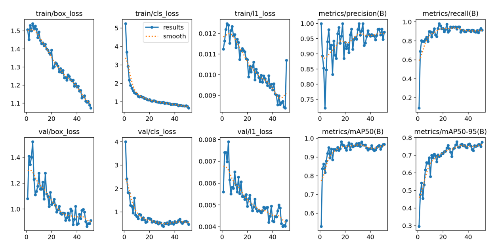
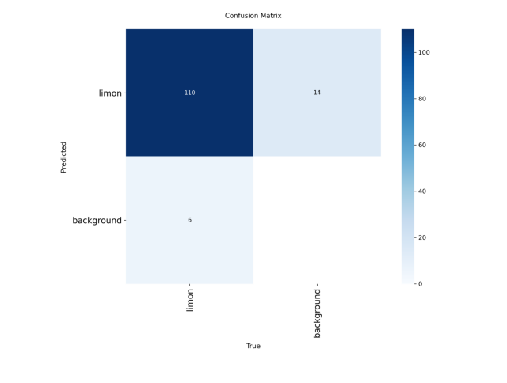
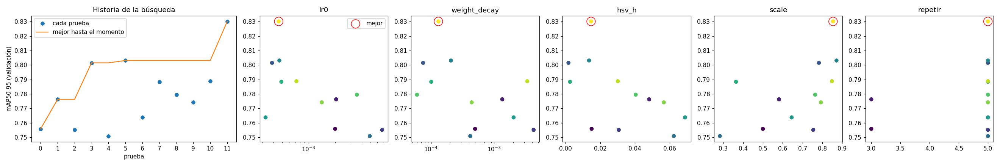
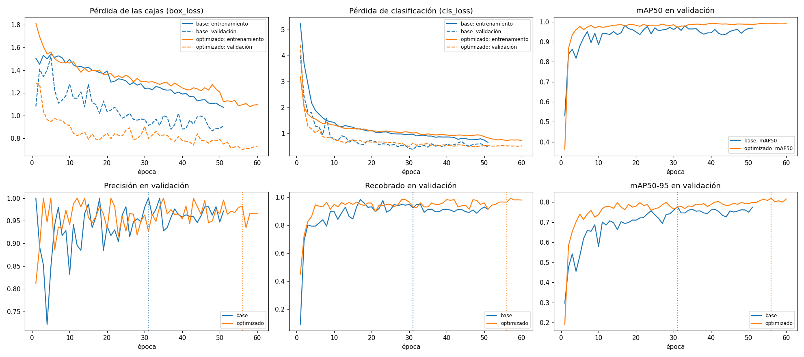
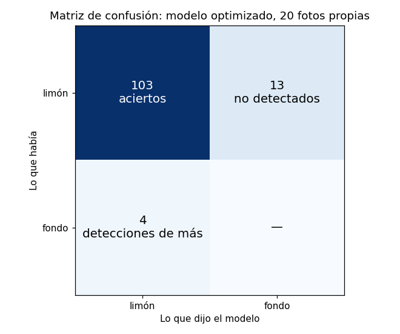
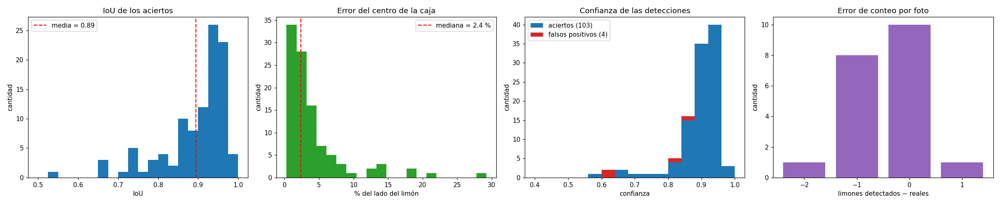
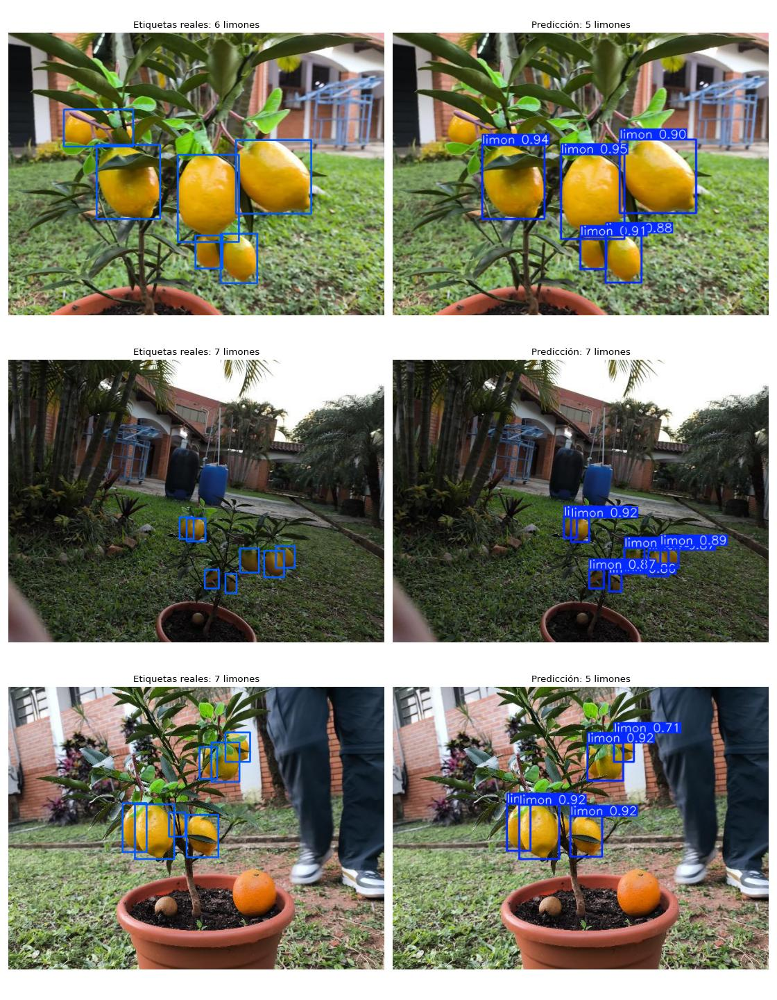

# Detector de limones con YOLO para un robot recolector

Proyecto de la materia Inteligencia Artificial. Entrena y optimiza una red **YOLO26n** que detecta limones
amarillos en la imagen de la cámara de un robot recolector, y analiza sus errores.

> **Origen del trabajo.** El detector nace del trabajo grupal de Robótica 1 (Grupo 2, FIUNA, 2026), del que formo parte: el
> robot «Arturito R2D2», repositorio [HecVelaz/recolector_de_frutas](https://github.com/HecVelaz/recolector_de_frutas).
> De ahí vienen el dataset propio, la limpieza de los datos y la configuración del modelo base (versión 3 del
> detector). Para Inteligencia Artificial se reorganizó ese trabajo y se agregaron la generación de features,
> la optimización de hiperparámetros con Optuna y el análisis de errores.

## El problema

El robot se detiene frente a un limonero y tiene que responder: **¿hay limones en la imagen y dónde están?**
La red entrega una caja y una confianza por cada limón; con eso, el resto del robot calcula la posición y mueve
el brazo. El requisito es **precisión y recobrado de 0,80 o más**.

El detector está pensado y validado para un **ambiente controlado**: un limonero en maceta con limones
amarillos, al aire libre, en el patio de la facultad. No se probó en un cultivo real.

## Estructura del repositorio

```
├── data/                 datos (no se versionan: los descarga el notebook 01)
├── notebooks/
│   ├── 01_preprocesamiento.ipynb   limpieza, unificación y generación de features
│   ├── 02_entrenamiento.ipynb      modelo base y evaluación preliminar
│   ├── 03_optimizacion.ipynb       búsqueda de hiperparámetros con Optuna
│   └── 04_visualizacion.ipynb      predicciones, curvas, matriz de confusión e histogramas de errores
├── results/              tablas CSV y figuras que generan los notebooks
│   └── referencia_v3/    resultados de la corrida del grupo de Robótica (12/11/2026)
├── requirements.txt
└── README.md
```

## Datos

| Dataset | Fuente | Qué aporta |
|---|---|---|
| Base | [brinjalproject/lemons-segmentation](https://universe.roboflow.com/brinjalproject/lemons-segmentation) (Roboflow Universe, v5) | 915 imágenes públicas de limones amarillos en el árbol (1 315 limones). Solo para entrenar |
| Propio | [limones-amarillos](https://universe.roboflow.com/hectors-workspace-e5dhh/limones-amarillos) (Roboflow Universe, v3, CC BY 4.0) | 50 fotos del limonero del laboratorio, sacadas con celular y etiquetadas por el grupo (291 limones): 30 para entrenar, 10 para validar y 10 de test |

**Preprocesamiento** (notebook 01):

- Los polígonos del dataset base se convierten en cajas.
- Las tres clases del dataset base se reducen a una, `limon`: solo cuenta la de limones amarillos.
- Las imágenes con limones verdes o enfermos se descartan enteras (unas 2 000): si quedaran sin etiquetar, el
  modelo aprendería que un limón es fondo.
- Las 30 fotos propias de entrenamiento se repiten (sobremuestreo) para que pesen más frente a las 915 públicas.

## Features generadas

Por cada limón etiquetado se calculan cuatro características nuevas a partir de los datos crudos (los píxeles y
los cuatro números de la caja). Quedan en `results/features_limones.csv`.

| Feature | Cómo se genera | Qué información aporta |
|---|---|---|
| Tamaño (`lado_px`, `tamano`) | Raíz del área de la caja en una imagen de 640 px; se agrupa en chico, mediano y grande | Distancia al limón: los chicos son los más difíciles |
| Forma (`aspecto`) | Ancho de la caja dividido por su alto, en píxeles | Si se aleja de 1, el limón está tapado o cortado |
| Color (`tono`, `saturacion`, `brillo`) | Mediana de cada canal HSV en la mitad central de la caja | Madurez e iluminación |
| Densidad (`n_limones`) | Cantidad de limones etiquetados en la misma imagen | Racimos: limones que se tapan y detecciones duplicadas |

YOLO recibe la imagen completa y aprende sus propias características, así que estas features no entran como
columnas al modelo. Se usan para comparar el dataset público con las fotos propias, para elegir qué
hiperparámetros de aumento de datos optimizar y para ver en qué tipo de limón falla el modelo.

## Modelo

- **YOLO26n** (Ultralytics 8.4.153), la versión más liviana: tiene que correr en la Raspberry Pi 5 del robot.
- **Transfer learning:** parte de pesos preentrenados en COCO y se ajusta a la clase `limon`.
- **Modelo base:** imágenes de 640 px, hasta 60 épocas con parada temprana (20 épocas sin mejorar) e
  hiperparámetros por defecto.

## Optimización de hiperparámetros

Con **Optuna** (búsqueda bayesiana, TPE): 12 entrenamientos de hasta 30 épocas. Las primeras 5 pruebas
exploran el espacio y las 7 siguientes las guía el algoritmo con lo aprendido. Se maximiza el **mAP50-95**
sobre las 10 fotos propias de validación y se registran precisión, recobrado, F1, mAP50 y mAP50-95 de cada
prueba en `results/optuna_pruebas.csv`. La primera prueba usa los valores del modelo base, como referencia.

| Hiperparámetro | Qué controla | Rango |
|---|---|---|
| `lr0` | Tasa de aprendizaje inicial | 0,0003 a 0,01 |
| `weight_decay` | Regularización | 0,00005 a 0,005 |
| `hsv_h` | Variación al azar del tono (aumento de datos) | 0 a 0,08 |
| `scale` | Variación al azar del tamaño (aumento de datos) | 0,2 a 0,9 |
| `repetir` | Veces que se repite cada foto propia de entrenamiento | 1, 3 o 5 |

Con los mejores valores se hace un entrenamiento final, que se compara con el modelo base sobre las fotos de
test en el notebook 04.

## Resultados

### Modelo base: corrida de referencia

Resultados de la corrida del 12/11/2026 del grupo de Robótica, con la misma configuración que el modelo base
(detalle en [`results/referencia_v3/`](results/referencia_v3/)). Entrenó 51 épocas en 14,5 minutos (GPU T4); la
mejor fue la 31.

| Conjunto | Imágenes | Precisión | Recobrado | mAP50 | mAP50-95 |
|---|:---:|:---:|:---:|:---:|:---:|
| Fotos propias, valid + test | 20 | 0,929 | 0,922 | 0,952 | 0,746 |
| Fotos propias, solo test | 10 | 0,960 | 0,862 | 0,938 | 0,723 |

Cumple el requisito (precisión y recobrado ≥ 0,80). Sobre 116 limones: 110 detectados, 6 no detectados y 14
detecciones de más, casi todas el mismo limón marcado dos veces.





### Modelo optimizado

**Búsqueda (Optuna, 12 pruebas, mAP50-95 sobre las 10 fotos de validación).** Ganó la prueba 11 (`lr0` = 0,00046,
`weight_decay` = 0,00013, `hsv_h` = 0,015, `scale` = 0,85, `repetir` = 5) con 0,830, contra 0,756 de la prueba 0
(valores base). Las mejores pruebas tienen `lr0` bajo y `scale` alto. Todas las pruebas están en
[`results/optuna_pruebas.csv`](results/optuna_pruebas.csv) y los mejores valores en
[`results/mejores_hiperparametros.json`](results/mejores_hiperparametros.json).



**Base contra optimizado** (entrenamiento final de 60 épocas; mejor época: 56):

| Modelo | Conjunto | Imágenes | Precisión | Recobrado | mAP50 | mAP50-95 |
|---|---|:---:|:---:|:---:|:---:|:---:|
| Base | test | 10 | 0,960 | 0,862 | 0,938 | 0,723 |
| **Optimizado** | **test** | 10 | **0,963** | **0,948** | **0,967** | **0,729** |
| Base | valid + test | 20 | 0,929 | 0,922 | 0,952 | 0,746 |
| Optimizado | valid + test | 20 | 0,956 | 0,966 | 0,983 | 0,762 |

La validación se usó para elegir los hiperparámetros, así que **test es la cifra más honesta**. Ahí la mejora está
sobre todo en el recobrado (0,862 a 0,948); en mAP50-95 es de 0,006, que con 58 limones no es una diferencia
confiable. Se cumple el requisito de precisión y recobrado ≥ 0,80.



### Análisis de errores (notebook 04)

- Sobre las 20 fotos (116 limones; confianza ≥ 0,40, IoU ≥ 0,5): 103 aciertos, 4 falsos positivos y 13 limones no
  detectados (con ese umbral fijo el recobrado es 0,888; la tabla usa el umbral que maximiza F1).
- IoU medio de los aciertos 0,89; error mediano del centro de la caja 2,4 % del lado del limón.
- Exacta la cuenta de limones en 10 de 20 fotos; en 8 se cuenta uno de menos.
- Recobrado más bajo en limones **chicos** (0,67; solo 6 casos), **oscuros** (0,79) y en fotos de 5 o 6 limones (0,86).







## Reporte técnico (formato IEEE)

El artículo está en [`reporte/articulo.pdf`](reporte/articulo.pdf). Sigue la plantilla IEEE de conferencia
(`IEEEtran`). El código fuente en LaTeX es `reporte/articulo.tex`, y se compila con `pdflatex` o se sube
completo a [Overleaf](https://www.overleaf.com).

## Cómo reproducirlo

Los notebooks están pensados para **Google Colab** y se corren en orden. Guardan todo en la carpeta
`limon_ia` de Google Drive, con la misma estructura que este repositorio (`data/`, `results/`, `runs/`).

1. Subir los cuatro notebooks a Colab.
2. Crear una cuenta gratis en [roboflow.com](https://roboflow.com), copiar la API key (*Settings → API Keys*) y
   guardarla como secreto de Colab con el nombre `ROBOFLOW_API_KEY`.
3. Correr `01_preprocesamiento` (sin GPU, unos minutos).
4. En los demás, elegir *Entorno de ejecución → Cambiar tipo de entorno de ejecución → GPU (T4)* y correr:
   `02_entrenamiento` (unos 15 minutos), `03_optimizacion` (unas 2 horas; si se corta, se vuelve a correr y
   continúa) y `04_visualizacion` (unos minutos).
5. Bajar de Drive la carpeta `limon_ia/results` y copiarla en `results/` del repositorio.

Fuera de Colab: `pip install -r requirements.txt`, definir la variable de entorno `ROBOFLOW_API_KEY` y abrir
los notebooks desde la carpeta `notebooks/`.

## Versiones anteriores del detector

| Versión | Limones | Datos | Resultado |
|---|---|---|---|
| v1 (28/09/2026) | Verdes | 2 datasets públicos | Sin métricas registradas |
| v2 (28/10/2026) | Verdes | 3 datasets públicos, 8 847 imágenes | Precisión 0,894 y recobrado 0,832 sobre 335 imágenes públicas. Entrenar llevaba horas. En fotos nuevas marcaba naranjas como limones y no detectaba limones amarillos |
| **v3 (12/11/2026)** | Amarillos | Dataset público + 50 fotos propias | La de la tabla de arriba: base de este proyecto |

Los números de v2 y v3 no son comparables entre sí: se midieron con imágenes distintas.

## Limitaciones

- **Pocas fotos de evaluación.** El test tiene 10 fotos (58 limones): un limón de más o de menos mueve las
  métricas en el segundo decimal, y diferencias chicas entre modelos pueden ser ruido.
- **Métricas optimistas.** Las 50 fotos propias son del mismo árbol y del mismo día, así que fotos casi iguales
  quedan en entrenamiento y en evaluación.
- **Otra cámara.** Las fotos son de celular; el robot usa cámaras Raspberry Pi NoIR, que al sol cambian los
  colores.
- **Ambiente controlado.** Un solo limonero en maceta, limones amarillos. No distingue madurez ni otras frutas.
- **Dataset base incompleto.** Tiene limones sin etiquetar, lo que baja las métricas medidas sobre él.

## Trabajo futuro

- Sumar fotos tomadas con las cámaras del robot, en otros días y con otra luz, y usarlas como test.
- Filtrar las detecciones duplicadas del mismo limón.
- Medir la velocidad del modelo en la Raspberry Pi 5.

## Referencias

- Grupo 2, Robótica 2 FIUNA (2026). *limones-amarillos* (versión 3) [Dataset]. Roboflow Universe. CC BY 4.0.
  https://universe.roboflow.com/hectors-workspace-e5dhh/limones-amarillos
- brinjalproject (s. f.). *lemons-segmentation* (versión 5) [Dataset]. Roboflow Universe.
  https://universe.roboflow.com/brinjalproject/lemons-segmentation
- Jocher, G. y Qiu, J. (2026). *Ultralytics YOLO26* (versión 8.4.153) [Software]. AGPL-3.0.
  https://github.com/ultralytics/ultralytics
- Akiba, T. et al. (2019). *Optuna: A Next-generation Hyperparameter Optimization Framework*. KDD 2019.
  https://optuna.org
